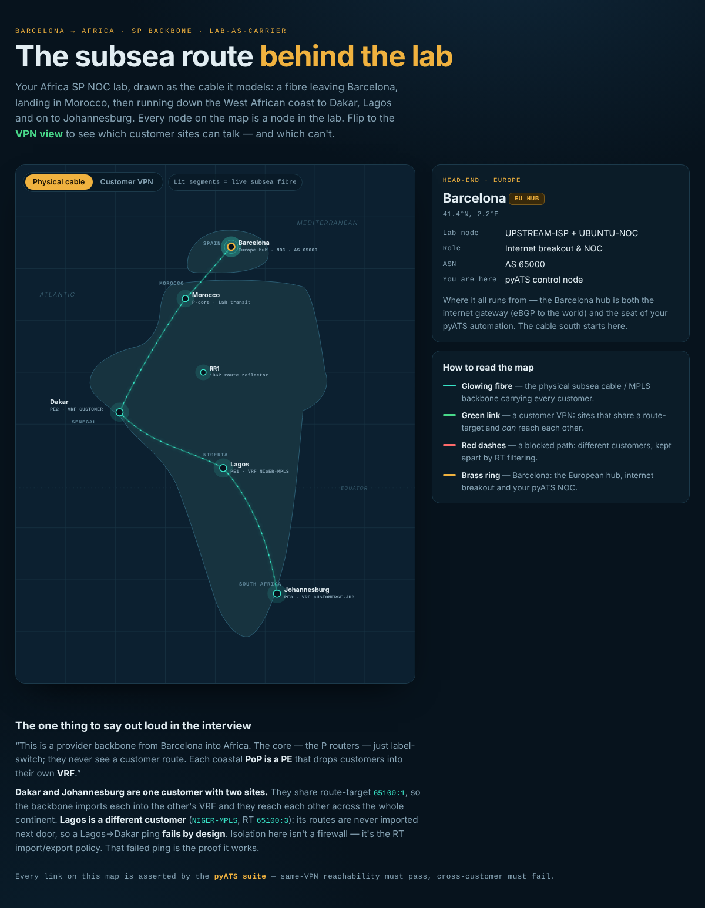

# Africa SP NOC — pyATS Validation Suite

Automated validation for a service-provider **MPLS / L3VPN** backbone built in
Cisco CML. It turns the manual NOC checks (OSPF, LDP, BGP-VPNv4, and the
customer-VPN reachability/isolation) into a repeatable test suite:
**green = healthy, red = something broke.**

The suite runs from an **in-lab Ubuntu NOC node** and connects to every router
over the management network — the same way a real NOC validates a change
window, in one command instead of logging into nine boxes.

> The lab drawn as the real carrier it models — Barcelona → Morocco → Dakar →
> Lagos → Johannesburg — is in [`docs/subsea-backbone-map.html`](docs/subsea-backbone-map.html)
> (open it in a browser for the interactive physical/VPN toggle).



---

## The network

A provider core (OSPF + LDP, iBGP route reflector) with three PoPs, each a PE
dropping customers into a VRF. Two customers, one of them multi-site:

| PoP (PE) | Loopback | Role | Customer / VRF | Route-target |
|---|---|---|---|---|
| **SP-PE2-DAKAR** | 10.0.0.2 | Senegal PoP | `CUSTOMER` — site 1 | `65100:1` (shared) |
| **SP-PE3-JHB** | 10.0.0.3 | S.Africa PoP | `CUSTOMER` — site 2 | `65100:1` (shared) |
| **SP-PE1-LAGOS** | 10.0.0.1 | Nigeria PoP | `NIGER-MPLS` — isolated | `65100:2` (own) |
| SP-P1-CORE / SP-P2-CORE | 10.0.0.4/.5 | P / LSR (label switching only) | — | — |
| SP-RR1 | 10.0.0.6 | iBGP VPNv4 route reflector | — | — |

Customer prefixes: Senegal `192.168.20.0/24`, S.Africa `192.168.30.0/24`,
Niger `192.168.40.0/24`.

**The story:** Dakar and Johannesburg share VRF `CUSTOMER` / RT `65100:1`, so
the backbone imports each site into the other — one customer, two sites,
reachable across the continent. Lagos is a *different* customer (RT `65100:2`),
never imported next door, so Lagos → Dakar **fails by design**. Isolation here
is the route-target policy, not a firewall.

---

## NOC control-node design

```
        NAT (UPSTREAM-ISP) ──ens2── [ UBUNTU-NOC ] ──ens3── Gi0/2  SP-P2-CORE
              internet,                   │                        10.99.99.1
              pip install            10.99.99.10                       │
                                          │           advertised into OSPF (area 0)
                                 route 10.0.0.0/24 ───────────────────┘
                                          │
                              telnet to loopbacks 10.0.0.1–.6
```

The NOC hangs off one core interface. Advertising `10.99.99.0/24` into OSPF
means **every router learns the path to the control node automatically** — no
static routes scattered across the core. pyATS reaches all six loopbacks from a
single management subnet.

> Telnet (not SSH) is used on purpose: Ubuntu 24.04's OpenSSH rejects IOSv's
> legacy crypto by default, and this is a closed management segment — telnet
> sidesteps a `KexAlgorithms`/`HostKeyAlgorithms` rabbit hole. Swap to SSH in
> the testbed when the devices run modern crypto.

---

## What it validates

**`tests/test_control_plane.py`** — is the backbone healthy?

| Testcase | Proves |
|---|---|
| `OSPF_Adjacencies` | every OSPF neighbor is `FULL` |
| `LDP_Sessions` | LDP label distribution is operational |
| `BGP_VPNv4` | PE↔RR VPNv4 sessions established (P routers correctly show 0) |

**`tests/test_vpn_services.py`** — do the customer VPNs behave?

| Testcase | Assertion |
|---|---|
| `SameVPN_Import` | PE2 imports S.Africa **and** PE3 imports Senegal, both via VPNv4 (AD 200) |
| `VPN_Isolation` | PE1 `NIGER-MPLS` holds its own route and **must NOT** see the `CUSTOMER` prefixes |

`VPN_Isolation` is the standout: it asserts that two customers **cannot** reach
each other, so an accidental route-target leak turns the suite red the moment it
happens. It checks **route presence**, not ping, because a PE sources pings from
its PE-CE link (not advertised across the VPN), so a correct VPN can still show
0% ping — the routing table is the truth.

---

## Run it

On the Ubuntu NOC node:

```bash
# one-time
python3 -m venv ~/venv && source ~/venv/bin/activate
pip install -r requirements.txt

# credentials (never hard-coded in the testbed)
export PYATS_USERNAME=netauto
export PYATS_PASSWORD='<your-password>'
export PYATS_ENABLE='<your-password>'

# full suite
pyats run job jobs/full_test_job.py --testbed-file testbed/testbed.yaml
```

### Last run

```
Task-1: test_control_plane .................... PASSED
  OSPF_Adjacencies / LDP_Sessions / BGP_VPNv4 ... PASSED (6 devices each)
Task-2: test_vpn_services ..................... PASSED
  SameVPN_Import  (dakar_imports_safrica, jhb_imports_senegal) ... PASSED
  VPN_Isolation   (NIGER-MPLS must NOT reach Senegal / S.Africa) . PASSED
Success Rate: 100.00 %
```

---

## Prerequisites

- A Linux control node that can reach the device loopbacks (here: an in-lab
  Ubuntu 24.04 node on a management subnet advertised into OSPF).
- Telnet (or SSH) + a `privilege 15` login on each router:
  ```
  username netauto privilege 15 secret <your-password>
  line vty 0 4
   login local
   transport input ssh telnet
  ```

## Layout

```
sp-noc-pyats/
├── README.md
├── requirements.txt
├── testbed/testbed.yaml          # 6 devices, telnet, env-var credentials
├── tests/
│   ├── test_control_plane.py     # OSPF / LDP / BGP-VPNv4
│   └── test_vpn_services.py      # VRF import + the isolation proof
├── jobs/full_test_job.py         # runs both, control plane first
└── docs/subsea-backbone-map.html # the lab as a subsea SP route
```

## Tuning

- Different device IPs → edit `testbed/testbed.yaml`.
- A fourth site → add its CE and prefix to `test_vpn_services.py`.
- Modern crypto on the devices → switch `protocol: telnet` to `ssh`.
